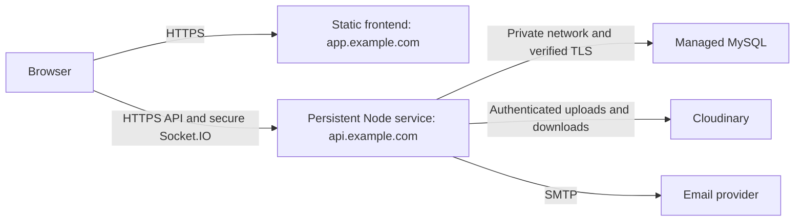

# SUPPORTFLOW PHASE 20.1 DEPLOYMENT PLAN

Historical Phase 20.1 inspection snapshot. See [Phase 20.2 environment preparation](DEPLOYMENT.md) for implemented verified MySQL TLS options and Node engine declarations; later deployment gates remain applicable.

Status: architecture review and planning only. No deployment, production migration, account creation, DNS change, secret upload, or Phase 20.2 implementation was performed. Application behavior is unchanged.

## Architecture and decisions

Use a static React/Vite frontend, one persistent Node/Express service, managed MySQL, Cloudinary for attachments, and SMTP for email. Keep provider selection outside application logic. Start with one backend instance; neither Redis nor a Socket.IO adapter is introduced here.

These are illustrative domains, not configured production URLs. Prefer HTTPS `app.example.com` and `api.example.com`: different origins, but the same site. Keep the API refresh cookie host-only. Unrelated hosting-provider domains may be different sites even when both use HTTPS; determine their actual registrable-domain relationship before selecting them. Current `SameSite=Lax` cookies cannot support cross-site background refresh requests. A cross-site design would require a later cookie change to `SameSite=None; Secure`, a CSRF review, and browser acceptance testing; third-party-cookie restrictions can still prevent refresh. See [MDN cookie semantics](https://developer.mozilla.org/en-US/docs/Web/HTTP/Reference/Headers/Set-Cookie) and [third-party-cookie limitations](https://developer.mozilla.org/en-US/docs/Web/Privacy/Guides/Third-party_cookies).

## Confirmed build and runtime requirements

| Item | Repository finding / planned operation |
| --- | --- |
| Frontend install | From `client/`, `npm ci` including dev dependencies (Vite and plugins are build tools). |
| Frontend build command | From `client/`, `npm run build`. |
| Frontend output | `client/dist/`; Vite config does not override `outDir` or `base`. Deploy at the frontend origin root. |
| Frontend required env | Only `VITE_API_BASE_URL`, e.g. `https://api.example.com/api/v1`. Include `/api/v1` once, without a trailing slash. |
| Node | Neither package declares `engines`; no version pin was found. Installed Vite 8.2.2 requires `^20.19.0 || >=22.12.0`; Express 5 requires Node >=18. Select and pin a supported LTS version satisfying the full lockfiles before deployment; verify both clean installs/builds on it. Do not infer that Node 18 suffices for the frontend. |
| Backend install | From `server/`, `npm ci --omit=dev` using the committed lockfile. |
| Backend start command | From `server/`, `npm start` → `node src/server.js`. Nodemon is development-only. |
| Backend entry point | `server/src/server.js` loads env validation, imports `src/app.js`, tests DB connectivity, creates an HTTP server, and initializes Socket.IO before listening. |
| PORT | `process.env.PORT || 5000`; no loopback-only host binding. Platform must supply a valid numeric port if overriding. |
| Health | `GET /api/v1/health`: DB `SELECT 1`, HTTP 200 with success and server/database `UP`; DB failure becomes generic HTTP 500. No credentials, hostnames, versions, or stack traces. |

Runtime env variables override the backend `.env`, which startup resolves relative to `server/`. Seed scripts load dotenv from their working directory: run them from `server/`. Real env files stay untracked. There is no migration command in `server/package.json`, and no backend lint/general-test npm script; do not invent one.

## Complete environment matrix

Names below come from source and `.env.example` files. No real values are included. All backend rows are server runtime configuration unless explicitly marked bootstrap-only.

| Group | Variables | Requirement / behavior |
| --- | --- | --- |
| Backend | `NODE_ENV` | Set `production`; controls Secure cookies, strict JWT checks, logging, security headers, and default rate limit. |
| Backend | `PORT` | Platform runtime port; local fallback 5000; validation 1–65535. |
| Frontend | `VITE_API_BASE_URL` | Public build-time HTTPS API base including `/api/v1`; changing it requires a frontend rebuild. |
| Database | `DB_HOST`, `DB_USER`, `DB_PASSWORD`, `DB_NAME` | Required at startup; dedicated production credentials only on server. |
| Database | `DB_PORT` | Optional; default 3306. No implemented DB TLS/CA or pool-size env variables. |
| JWT/Auth | `JWT_ACCESS_SECRET`, `JWT_REFRESH_SECRET` | Required, independently generated random secrets; production requires distinct values of at least 32 characters and rejects weak patterns. |
| JWT/Auth | `JWT_ACCESS_EXPIRES_IN`, `JWT_REFRESH_EXPIRES_IN` | Both required; positive finite JWT durations, refresh longer than access. Example durations in template: 15m / 7d. |
| Cloudinary | `CLOUDINARY_CLOUD_NAME`, `CLOUDINARY_API_KEY`, `CLOUDINARY_API_SECRET` | All required at startup; keep all on backend, especially API secret. |
| Email | `SMTP_HOST`, `SMTP_PORT`, `SMTP_USER`, `SMTP_PASS`, `EMAIL_FROM_ADDRESS` | Whole group optional for server startup, but all required when any is configured. Production recovery/Admin reset requires working email. |
| Email | `SMTP_SECURE` | Optional `true` / `false`, default false; match provider transport requirements. |
| Email | `EMAIL_FROM_NAME` | Optional, default SupportFlow; sender address must be verified with provider. |
| CORS/URLs | `CLIENT_URL` | Required in production: one exact HTTP(S) frontend origin; plan HTTPS. No path, wildcard, userinfo, query, or fragment. Shared by Express CORS, Socket.IO, and reset links. |
| Password reset | `PASSWORD_RESET_TTL_MINUTES` | Optional; default 15, supported integer range 5–30. |
| Initial Admin | `INITIAL_ADMIN_FIRST_NAME`, `INITIAL_ADMIN_LAST_NAME`, `INITIAL_ADMIN_EMAIL`, `INITIAL_ADMIN_PASSWORD` | Required only for `npm run seed:admin`, not normal server startup. Inject temporarily for bootstrap. |
| Optional security | `API_RATE_LIMIT_WINDOW_MS`, `API_RATE_LIMIT_MAX` | Positive bounded integers; defaults 900000 ms and 1000 requests outside development (5000 in development). Invalid overrides fall back to defaults. |
| Optional security | `LOGIN_RATE_LIMIT_WINDOW_MS`, `LOGIN_RATE_LIMIT_MAX` | Defaults 900000 ms / 5 failed requests; successful requests do not count. |

There are no implemented `FRONTEND_URL`, separate API runtime URL, `VITE_SOCKET_URL`, reset-URL, cookie-SameSite/domain, `TRUST_PROXY`, Cloudinary-folder, or DB-SSL environment switches. Do not populate imaginary settings expecting behavior changes. The frontend derives the Socket.IO origin from `VITE_API_BASE_URL`; Socket.IO uses the backend origin and default `/socket.io/` path, not `/api/v1/socket.io/`.

Frontend source references only `VITE_API_BASE_URL`. All `VITE_*` values are public and bundled: never add DB passwords, JWT secrets, Cloudinary secrets, SMTP passwords, or bootstrap credentials to frontend build configuration. Isolate client/server build environments and review built assets for unintended secret exposure before publishing.

## Cookies, CORS, proxy, and HTTPS

`server/src/utils/authCookie.js` currently sets `refreshToken` with HttpOnly, Secure when `NODE_ENV=production`, `SameSite=Lax`, path `/api/v1/auth`, and no Domain attribute (host-only); expiry follows the refresh token. Clearing uses matching attributes. Preserve these for the recommended same-site HTTPS subdomains. Axios already enables credentialed requests. Access tokens remain in frontend memory; do not persist credentials or tokens to browser storage.

`server/src/config/cors.js` provides the same single-origin policy for REST and Socket.IO; credentials are enabled, and Socket.IO also checks WebSocket handshake origins. With production `CLIENT_URL` set, localhost is not additionally allowed. Development falls back to `http://localhost:5173` only when the variable is absent. No wildcard credentialed CORS. Originless non-browser requests are possible; CORS is not an authorization mechanism. Preserve existing authentication and authorization checks.

Expect TLS termination at a hosting reverse proxy. HTTPS must cover frontend/API, secure Socket.IO upgrades, and all redirects. Forward `/socket.io/` polling and WebSocket upgrades with timeouts suitable for long-lived connections. Never use a serverless-only backend for the current architecture. Avoid sleep-on-idle if reliable realtime is required; sleeping/restarting disconnects sockets and can interrupt in-process recovery email work.

Express currently leaves `trust proxy` false. Behind a proxy, `req.ip` can identify the proxy, grouping users into one rate-limit bucket and recording proxy addresses in audit logs. After the host is chosen, configure only its documented trusted proxy addresses/hop topology and ensure forwarded headers are sanitized and direct bypass is prevented. Do not blindly set true or assume one hop. Current cookie Secure is set explicitly from `NODE_ENV`, not `req.secure`, so missing trust does not itself disable that flag. See [Express proxy guidance](https://expressjs.com/en/guide/behind-proxies/).

Limiters use process-local memory, reset on restart, and are not shared across instances. Recovery limits are fixed at 3 forgot requests / 10 reset attempts per 15 minutes. The general API limiter includes health; choose monitoring frequency and proxy setup to avoid accidental 429 health failures. Health checks prove API/DB readiness, not SMTP, Cloudinary, or socket delivery. Do not scale out without revisiting limiter storage, Socket.IO adapters, and routing affinity for polling.

## Database initialization and Admin bootstrap

The pool in `server/src/config/database.js` has 10 connections, queued acquisition, parameterized query support, `multipleStatements:false`, and BIGINT identity handling. It has **no SSL/TLS options**. For managed MySQL requiring verified TLS, adding provider-appropriate CA/certificate verification is a definite later implementation prerequisite; setting an undocumented `DB_SSL` variable does nothing. Do not disable certificate verification to bypass this gap. Use private connectivity/IP restrictions, least-privilege runtime grants, a separate migration identity, backups, and provider connection limits allowing for the pool and maintenance connections. The browser never connects to MySQL.

Create an empty production database separately, with an agreed UTF-8 charset/collation and SQL mode. The repository contains 22 numbered SQL files under `server/database/migrations/` (001 through 022), not an automated migration runner or schema-version ledger. Apply each once in numeric order through a controlled SQL client/release job against the selected database; retain an external applied-file/checksum record. Inspect multi-statement migration 019 and client compatibility; do not send all files through the application pool or assume every DDL file is safely repeatable. Test the full chain on a fresh managed-engine staging database first, including foreign keys, CHECK enforcement, indexes, defaults, and timezone behavior. Prefer a supported MySQL 8-compatible engine; compatibility is not yet demonstrated against a production provider.

After schema initialization, run from `server/`:

1. `npm run seed:categories` (002 seed).
2. `npm run seed:priorities` (003 seed).
3. `npm run seed:sla` (004 seed; requires exactly one matching default priority).
4. `npm run seed:admin` once, with temporary bootstrap env available only to that job.

Seeds preserve existing records, but inspect conflicts rather than blindly retrying. Do not run `005_seed_audit_demo.js` in production; it is development-only. There is no required demo or knowledge-base data seed. Do not import development users, sessions, tickets, reset tokens, or audit demo data.

Admin seed hashes the supplied password, creates an active ADMIN with `must_change_password=TRUE`, and skips any existing email without resetting/promoting it. Supply a unique strong temporary password following the current policy (8–1024 characters with uppercase/lowercase/digit); the seed itself is not a password-policy validator. Verify the existing email actually belongs to the intended Admin if skipped. Complete the forced change through HTTPS, verify the resulting role/session behavior, then remove the bootstrap password from job/platform configuration. Never store it in Git, shell history, screenshots, or logs. User-facing reset/change password remain distinct flows.

## Cloudinary, email, filesystem, and logging

Attachments use Multer memory storage (one file, maximum 10 MB), metadata/content validation, and Cloudinary upload streams. There is no permanent local attachment filesystem or temporary disk-upload directory. Budget memory for concurrent uploads and proxy body limits. Keep the existing MIME/extension/signature restrictions and authenticated download authorization.

Cloudinary uploads use fixed folder `supportflow/tickets`, random asset identities, explicit image/raw resource types, allowed formats, no overwrite, and authenticated delivery. The folder is sensible within a dedicated production Cloudinary environment; use separate environments/accounts for staging and production because folder names are not configurable. Verify production upload, authorized download, deletion, signed URLs, HTTPS URLs, and legacy attachment delivery types. DB metadata and Cloudinary assets need coordinated retention/backups; restoring the DB does not restore deleted remote assets.

Nodemailer uses runtime SMTP credentials and structured sender identity; provider network access, verified sender/domain, quotas, and SPF/DKIM/DMARC setup must be validated later. Match `SMTP_SECURE` and port to the provider (implicit TLS versus STARTTLS); verify the provider's encryption requirements, since the current transport does not explicitly require STARTTLS. Health/startup do not verify SMTP connectivity. Existing notification email templates are present, but their existence does not establish automatic delivery for every notification event; test only actual wired flows. In-app/Socket.IO delivery remains separate from email.

Password recovery and Admin reset build `new URL('/reset-password', clientOrigin())`, then append a token. Set `CLIENT_URL=https://app.example.com` before enabling delivery; no localhost fallback is permitted by production startup validation, but production validation currently accepts HTTP, so operators must enforce HTTPS. Do not derive reset URLs from request Host headers. Keep token query strings out of frontend/CDN/proxy/access/error logs and analytics. Recovery request work is in-process, not a durable job queue; restarts can interrupt pending mail.

Application request logs include method, path without query, status, and elapsed time; no bodies or credential headers. Unexpected errors and provider failures use generic messages; Socket.IO connection logs are development-only. Health returns no detailed infrastructure data. Preserve these boundaries in platform logging too: redact Authorization, Cookie/Set-Cookie, passwords, raw JWTs/reset links, SMTP and DB credentials. Infrastructure logs may otherwise capture reset-page query strings even though backend Morgan does not. Generic error logging has limited diagnostics; use safe operation/status context when investigating rather than enabling raw request/error dumps.

## Static frontend routing and configuration separation

Configure the static host to serve existing files normally and rewrite unknown frontend routes to `/index.html` with HTTP 200. Verify direct navigation/refresh to `/employee/tickets/123`, `/reset-password?token=...`, and `/admin/reports`, preserving query strings without logging tokens. Do not rewrite backend `/api/v1/*` or `/socket.io/*` to HTML. Avoid long caching of index.html; hashed assets can be cached immutably. `vite preview` is a local preview, not the production web service.

Vite variables are baked into assets at build time; setting API variables only at static-host runtime will not update a built bundle. Backend variables are read at process startup; restart the service after changes. Arrange API/Socket URL, CORS frontend origin, and reset-link origin as one coordinated configuration set. Existing HTTPS and trusted-origin validation must be checked against actual final domains before release.

## Deployment sequence for later phases

Configure secrets before starting services and public build variables before building; the following order refines the proposed deployment sequence to avoid launching with incomplete configuration.

1. Select host capabilities, same-site domains, supported Node/MySQL versions, trusted proxy topology, and rollback owner. Resolve TLS/proxy prerequisites in their authorized later phases.
2. Create managed MySQL and backups; configure network restrictions, verified TLS, migration/runtime identities, and connectivity.
3. Rehearse and apply schema migrations 001–022 with an applied-file record and pre-change backup.
4. Run categories, priorities, and SLA seeds; create the initial Admin in the controlled bootstrap job (or immediately before first login, while access is restricted).
5. Configure backend runtime env, JWT keys, final `CLIENT_URL`, Cloudinary, and working SMTP before starting the persistent backend. Deploy an immutable revision and start with `npm start`.
6. Verify backend health, DB permissions, TLS/redirects, proxy-derived IP behavior, cookie flags, CORS rejection/acceptance, upload limits, and safe logs.
7. Set frontend `VITE_API_BASE_URL` before `npm ci` / `npm run build`; deploy `dist` to the static host with SPA fallback and HTTPS.
8. Verify final URLs together: frontend origin, API path, `/socket.io/`, cookie scope, and generated reset links. Restart/rebuild the appropriate component if configuration changes.
9. Verify Cloudinary upload/download/deletion and real email delivery; confirm actual reset links use the final HTTPS frontend.
10. Verify persistent Socket.IO connection, authentication, reconnect, targeted notifications, and operation after a backend restart.
11. Verify initial Admin, complete forced change, remove bootstrap secret, and check login, refresh, logout, self-service change, recovery, and Admin reset.
12. Smoke-test all role entry points, route refreshes, CORS/cookies in target browsers, and negative authorization cases.
13. Run a full deployed Employee ticket → Admin assignment → Technician updates/comments/attachments → resolution/feedback workflow, notifications, SLA, reports/exports, knowledge base, and audit review. Record deployment revision and sanitized evidence before sign-off.

## Risks, release gates, and rollback

| Risk | Gate before release |
| --- | --- |
| Managed MySQL requires TLS unsupported by current pool config | Implement verified TLS in a later scoped phase; test with the selected service. |
| Reverse proxy groups users under one IP | Determine trusted forwarding topology; implement/test scoped proxy trust later. |
| Cross-site provider domains | Prefer same-site domains; otherwise deliberate cookie/CSRF work and target-browser tests are required. |
| CORS, API base, or reset origin mismatch | Validate exact final origin and `/api/v1` prefix; inspect generated links without logging tokens. |
| Serverless-only hosting, idle sleep, or short socket timeouts | Choose persistent WebSocket-capable service; accept/document free-tier disconnects only if appropriate. |
| SMTP blocked/partial/unencrypted configuration | Verify provider transport, sender identity, and real delivery; complete email is required for recovery features. |
| Missing SPA fallback or stale build variables | Test deep links and rebuild against the intended HTTPS API. |
| Cloudinary restrictions/environment mismatch | Test authenticated assets and separate production credentials/assets. |
| Untracked manual migration state / engine differences | Rehearse migration chain, track checksums, and back up before changes. |
| Memory exhaustion / quota exhaustion | Budget for in-memory uploads, pool size, email/asset quotas, and single-instance load. |

Keep the previous working backend revision and frontend artifact deployable together. Preserve production environment securely outside Git and record configuration changes without values. Prefer additive/backward-compatible migrations; roll application code back only when compatible with the new schema. Before destructive DDL, take a recoverable backup and define a maintenance window. Do not blindly reverse SQL or restore over new data: assess writes since backup and rehearse restore separately. Keep Cloudinary data when reverting code; avoid orphan cleanup until reconciliation. If JWT keys must rotate, expect forced reauthentication; never restore compromised secrets. A failed smoke test should stop promotion and use the last compatible deployment.

## Review evidence and scope

Inspected package manifests/lockfile engine constraints, Vite config and public env usage, startup/app configuration, pool, CORS/Socket.IO, refresh cookies, limiters, health, uploads/Cloudinary, mailer/reset links, logging/error handling, migrations and seeds. Definite configuration gaps are reported above, not patched. No provider has been selected or production capability claimed. This is documentation-only; build/runtime tests and production connectivity checks are not implied by this review. Final verification: inspect Git diff/status and whitespace checks. Phase 20.2 has not begun.
